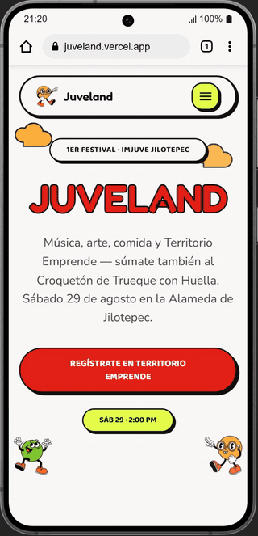

# Juveland

Landing del **1er Festival de las Juventudes de Jilotepec** (IMJUVE Jilotepec), celebrado el 29 de agosto de 2026 en la Alameda de Jilotepec.

**Sitio:** <https://juveland.vercel.app>

Astro · Tailwind CSS v4 · GSAP · TypeScript · Vercel

<p align="center">
  
</p>

## El reto

El festival ya tenía un cartel oficial con una identidad muy marcada: letras tipo burbuja con contorno negro, colores planos y saturados, mascotas y nubes. La idea era que el sitio se sintiera como ese cartel en movimiento y no como una landing genérica.

La restricción principal era otra: casi todo el tráfico iba a llegar por un link compartido en WhatsApp, abierto en celulares de gama media y con datos móviles. Por eso cada decisión visual tenía que justificar lo que pesaba.

## Qué construí

Una sola página con la información del evento: line-up de 9 bandas, cuenta regresiva, la campaña *Trueque con Huella*, mapa, los emprendimientos participantes y el registro para Territorio Emprende.

Algunas decisiones que vale la pena mencionar:

- **GSAP solo se carga cuando hace falta.** Ningún componente lo importa de forma estática. Cada sección espera a que termine el loader, observa su entrada al viewport con `IntersectionObserver` y apenas entonces hace `import()` de GSAP y ScrollTrigger. Si el JS falla o tarda, el contenido igual se lee. Esa lógica vive en un solo lugar: [`src/scripts/reveal.ts`](src/scripts/reveal.ts).
- **La navbar se encoge con CSS**, usando `animation-timeline: scroll()`. No tenía sentido cargar ~110 KB de JS para eso.
- **La cuenta regresiva no depende de la zona horaria del visitante** (hora fija en `-06:00`). Al llegar a cero muestra qué banda está tocando en ese momento y, cuando termina el evento, cambia a un mensaje de agradecimiento, así que el sitio sigue teniendo sentido después del festival.
- **Movimiento reducido y accesibilidad.** Todas las animaciones respetan `prefers-reduced-motion`. El menú móvil y el panel de información son diálogos con focus trap, se cierran con Escape y con el botón "atrás" del navegador.
- **El sistema visual está en tokens.** La paleta salió del cartel oficial, muestreada pixel por pixel. Colores, radios, espaciado y utilidades como `sticker-shadow` o `ink-outline` viven en el `@theme` de [`global.css`](src/styles/global.css), sin `tailwind.config.js`.
- **Las fuentes se sirven desde el propio sitio** (Fredoka, Baloo 2 y Nunito) con la API de fuentes de Astro, sin pedirle nada a Google Fonts en cada visita.
- **Una sola fuente de datos.** El line-up, las redes y la navegación se definen una vez en `src/data/` y se reutilizan en cada sección que los muestra.
- **Preview correcto en WhatsApp**: Open Graph y Twitter Card con URLs absolutas, canonical y sitemap.

## Estructura

```
src/
├─ pages/        index.astro (la landing) y style-guide.astro (referencia interna, noindex)
├─ layouts/      <head>, SEO, fuentes, analytics
├─ components/   una sección por archivo, más piezas compartidas
├─ data/         line-up, emprendedores, redes y navegación
├─ scripts/      loader, revelado por scroll, focus trap
└─ styles/       tokens de Tailwind v4 y utilidades
```

## Correr en local

Requiere Node 22.12 o superior y pnpm 11.

```sh
pnpm install
pnpm dev           # http://localhost:4321
pnpm build         # genera ./dist
pnpm astro check   # type-check
```

## Créditos

Diseño y desarrollo: yo, para IMJUVE Jilotepec. El cartel, las mascotas, los logotipos institucionales y las imágenes de bandas y emprendimientos pertenecen a IMJUVE Jilotepec y a sus respectivos dueños. Se publican aquí con autorización de IMJUVE, como parte de mi portafolio.
